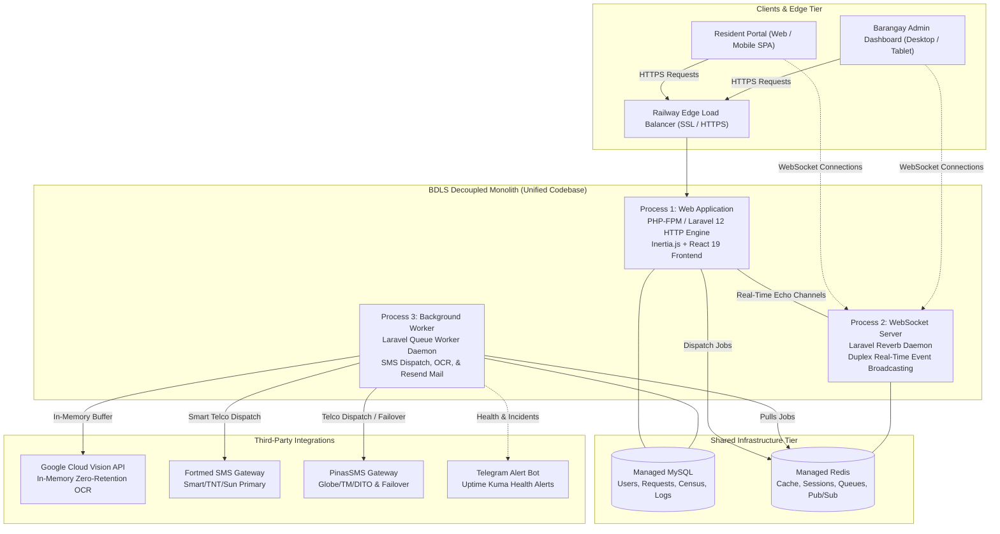

       

# 🏛️ Barangay Doña Lucia Services (BDLS)

### *Web-Based Service Request Queuing & Real-Time Notification Platform for Local Communities*

[](https://laravel.com)
[](https://react.dev)
[](https://inertiajs.com)
[](https://tailwindcss.com)
[](https://bun.sh)
[](https://railway.app)
[](https://github.com/louislam/uptime-kuma)

---

## 📖 Executive Summary & Mission

The **Barangay Doña Lucia Services (BDLS)** platform is a full-stack, enterprise-grade civic technology system engineered to digitize and modernize municipal public administration in **Barangay Doña Lucia, Quezon, Nueva Ecija, Philippines**.

Developed over an intensive **8-month engineering lifecycle** by a solo developer, BDLS completely replaced manual paper logbooks and fragmented communication with an automated, omnichannel digital queue, real-time WebSocket event streaming, zero-retention biometric verification, and an intelligent dual-carrier SMS gateway compliant with Philippine telecommunications laws.

Initially prototyped with traditional server-rendered templates, the platform underwent an end-to-end architectural migration to a reactive **React 19 + Inertia.js v3 Single Page Application (SPA)**, delivering near-instantaneous client transitions while retaining Laravel's robust backend security and ecosystem.

---

## 🏗️ System Architecture: The Decoupled Monolith

BDLS is architected and classified in production as a **Decoupled Monolith** (also known as a *Multi-Process Monolith*).

Unlike microservices—which introduce network latency, distributed transaction complexities, and independent service ownership overhead—BDLS maintains **a single, unified codebase deployed across three dedicated, concurrent runtime processes** running on **Railway**, all deploying atomically from the `main` branch and sharing managed data stores.



### The Three Deployable Processes

1. **HTTP Web Application (`web`):** Serves the Inertia.js React views, handles API routes, enforces rate limiting, session authentication, and streams protected files.
2. **WebSocket Real-Time Server (`reverb`):** Runs `php artisan reverb:start` to maintain persistent, low-latency duplex connections with client browsers for live queue re-ordering, active counter updates, and notifications.
3. **Background Queue Worker (`worker`):** Runs `php artisan queue:work` to consume asynchronous jobs off Redis (SMS blasts, email alerts, failover routing, and batch operations) without blocking user requests.

---

## ☁️ Cloud Infrastructure & Deployment on Railway

The BDLS production environment is hosted on **Railway**, leveraging modern containerized cloud primitives with zero-downtime release guarantees.

### 1. Automated CI/CD Engine (`nixpacks.toml`)

The application compiles and builds deterministically via **Nixpacks**:

- **Setup Phase:** Provisions PHP 8.3, Node.js, and the high-speed **Bun** package manager and runtime.
- **PHP Extensions:** Pre-compiles `apcu`, `pcntl` (for CLI queue and process handling), and `redis`.
- **Build Phase:**

  ```bash
  composer install --no-dev --optimize-autoloader
  bun install
  bun run build
  php artisan config:cache
  php artisan route:cache
  php artisan view:cache
  ```
- **Zero-Downtime Release Gate:**

  ```toml
  [phases.release]
  cmds = ["php artisan migrate --force"]
  ```

  Migrations run automatically before the new release goes live. If a migration encounters an error, Railway halts the deployment, preventing any production downtime.

### 2. Reverse Proxy & SSL Termination

Behind Railway's Edge Proxy:

- **Proxy Trusting:** Configured via `$middleware->trustProxies(at: '*')` in `bootstrap/app.php` to accurately interpret `X-Forwarded-Proto` and `X-Forwarded-For` headers.
- **Enforced HTTPS Scheme:** Configured via `URL::forceScheme('https')` in `AppServiceProvider.php` whenever deployed to production, completely eliminating **Mixed Content** errors on client-side Inertia XHR pagination and form requests.

### 3. High-Availability Monitoring (Uptime Kuma + Telegram)

- **24/7 Endpoint Health Checks:** Continuous heartbeats monitor HTTP response codes, latency spikes, and SSL certificate expiration dates.
- **Instant Telegram Incident Alerts:** Automated Telegram Bot alerts maintainers within seconds of an anomaly using strict HTML Liquid notification templates.

---

## ⚡ Key Technical Innovations & Subsystems

### 1. Zero-Retention OCR Biometric Identity Verification

To protect citizen privacy under Philippine Data Privacy laws:

- Resident sign-ups require uploading a valid Philippine Government ID and selfie.
- Uploaded media is processed **strictly in-memory** and streamed to the **Google Cloud Vision API** for Optical Character Recognition (OCR).
- Extracted names and dates of birth are cross-referenced against the local Barangay Census Masterlist (`census_records`).
- **Zero-Retention Guarantee:** Photos are purged from RAM immediately after verification; ID images are **never stored on disk or in the database**.

### 2. Dual-Engine Telco SMS Gateway with Auto-Failover

- **Intelligent Telco Routing:** Automatically inspects the recipient's mobile prefix:
  - **Smart / TNT / Sun** numbers route primarily through the **Fortmed (FMCSMS)** gateway.
  - **Globe / TM / DITO** numbers route directly through the **PinasSMS** gateway.
- **Automatic Failover:** If Fortmed times out or returns an error, the queue worker automatically retries the message through PinasSMS to ensure guaranteed delivery.
- **Philippine NTC Compliance Safeguards:**
  - **160-Character Optimizer:** Automatically calculates multi-part segments to optimize API credits.
  - **Night Curfew Blocker:** Strictly suppresses batch text blasts between **9:00 PM and 7:00 AM**.
  - **Link Filter:** Enforces a strict regex blocker preventing URLs in SMS payloads to protect the shared gateway from telecommunication fraud filters.
  - **Unicode Sanitizer:** Strips emojis and smart quotes to prevent UTF-16 character set inflation.

### 3. Secure Private Document Streaming

- Sensitive citizen attachments (GCash payment screenshots, certificates, affidavits) are stored in `storage/app/private/`.
- Direct public access via web roots is strictly disabled.
- Documents are streamed via `FileController@serveSecureFile` with strict directory traversal protection and authenticated ownership/admin authorization checks.

### 4. Omnichannel Digital Queuing with Shadow Accounts

- **Unified Queuing:** Online portal submissions and in-person walk-ins share a single, synchronized priority queue.
- **Walk-in Shadow Accounts:** Admins can create instant walk-in profiles (`W-001`, `W-002`) capturing names and contact numbers without requiring the resident to set passwords or have email accounts.

### 5. Multi-Action Floating Action Button (FAB)

- Barangay administrators can select multiple queued requests to batch-update statuses (e.g., *For Verification*, *Ready for Pickup*, *Completed*), generate bulk PDF clearances, and dispatch batch SMS alerts with a single click.

---

## 🛠️ Technology Stack Breakdown

| Layer                             | Technologies Used                                        |
| --------------------------------- | -------------------------------------------------------- |
| **Backend Framework**       | Laravel 12 (PHP 8.2+ / 8.3)                              |
| **Frontend Framework**      | React 19 + Inertia.js v3                                 |
| **Styling & Design**        | Tailwind CSS v4, Lucide Icons, Heroicons                 |
| **Asset Bundler & Runtime** | Vite 7, Bun v1.x                                         |
| **Real-Time WebSockets**    | Laravel Reverb + Laravel Echo + Pusher JS                |
| **Asynchronous Queues**     | Redis + Laravel Queue Workers                            |
| **Database Tier**           | MySQL (InnoDB, Foreign Key Integrity, B-Tree Indexes)    |
| **Cloud Hosting**           | Railway (Containerized Multi-Process Decoupled Monolith) |
| **AI / Machine Learning**   | Google Cloud Vision API (OCR Text Detection)             |
| **Telecommunications**      | Fortmed SMS Gateway & PinasSMS Dual-Engine Hybrid        |
| **Transactional Email**     | Resend API (`resend/resend-laravel`)                   |
| **Monitoring & Uptime**     | Uptime Kuma + Telegram Bot API                           |
| **Document Generation**     | DomPDF (`barryvdh/laravel-dompdf`)                     |

---

## 🚀 Local Development Setup

Follow these instructions to run the entire decoupled stack locally on your machine.

### Prerequisites

- **PHP 8.2+** with `pdo_mysql`, `intl`, `pcntl`, `redis` extensions
- **Composer** (v2.x)
- **Node.js** (v20+) or **Bun** (v1.x)
- **MySQL** (v8.x)
- **Redis Server** (v6+)

### 1. Clone the Repository

```bash
git clone https://github.com/RICHHACKER45/bdls-system.git
cd bdls-system
```

### 2. Install Dependencies

```bash
# Install PHP backend dependencies
composer install

# Install Frontend dependencies via Bun (or npm)
bun install
```

### 3. Environment Configuration

Create your local environment file:

```bash
cp .env.example .env
php artisan key:generate
```

Configure your `.env` file with your local database and credentials:

```ini
APP_NAME="Barangay Doña Lucia Services"
APP_ENV=local
APP_DEBUG=true
APP_URL=http://localhost:8000

# Database
DB_CONNECTION=mysql
DB_HOST=127.0.0.1
DB_PORT=3306
DB_DATABASE=bdls_db
DB_USERNAME=root
DB_PASSWORD=

# Cache, Sessions & Queues
CACHE_STORE=redis
SESSION_DRIVER=redis
QUEUE_CONNECTION=redis

REDIS_CLIENT=phpredis
REDIS_HOST=127.0.0.1
REDIS_PORT=6379

# WebSockets (Laravel Reverb)
BROADCAST_CONNECTION=reverb
REVERB_APP_ID=100001
REVERB_APP_KEY=bdls-local-reverb-key
REVERB_APP_SECRET=bdls-local-reverb-secret
REVERB_HOST="127.0.0.1"
REVERB_PORT=8080
REVERB_SCHEME=http

# Dual SMS Gateway
SMS_DRIVER=hybrid
PINASSMS_API_KEY=your_pinassms_key
FORTMED_SMS_API_KEY=your_fortmed_key

# Google Cloud Vision OCR
GOOGLE_CREDENTIALS_PATH=app/private/google-credentials.json
```

### 4. Database Setup & Seeding

Run migrations and populate the 13 official barangay document types, census records, and administrative test accounts:

```bash
npm run dbreset
# Runs: php artisan migrate:fresh --seed
```

### 5. Launch All Processes Concurrently

BDLS includes a concurrent runner that launches the Web server, Vite bundler, Queue worker, and Reverb WebSocket server simultaneously:

```bash
npm start
# Or using Composer:
composer run dev
```

Open your browser and navigate to:

```
http://localhost:8000
```

---

## 🧪 Testing & Code Quality

BDLS enforces strict code formatting, static analysis, and test suites:

```bash
# Run Pint (PHP code style fixer)
php vendor/bin/pint --format agent

# Run Prettier (React, JSX & CSS formatter)
bunx prettier --write .

# Run Automated PHPUnit Tests
php artisan test --compact
```

---

## 🏛️ Project Governance & Atomic Git Blueprint

To maintain a clean, traceable history across the 8-month development cycle, all code contributions adhere to atomic commit standards:

- `feat:` For new features or backend business logic.
- `fix:` For bug fixes or patch resolutions.
- `refactor:` For code restructuring without functionality changes.
- `style:` For UI, Tailwind CSS, or aesthetic formatting.

---

## 👨‍💻 Author & Acknowledgements

**Lead Full-Stack Solely Developer of this System:**

- **RichkillDev45** ([GitHub: @RICHHACKER45](https://github.com/RICHHACKER45))

Dedicated to the community and public servants of **Barangay Doña Lucia, Quezon, Nueva Ecija**. Designed and engineered to bring fast, transparent, and dignified municipal digital services to every resident.
